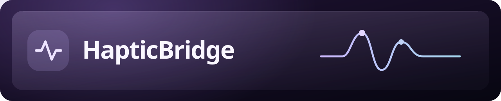

<p align="center">
  
</p>

<p align="center">
  <a href="https://github.com/mrpixen/HapticBridge/releases"><strong>Download for Windows</strong></a> ·
  <a href="docs/SCREEN-SYNC.md">Screen sync setup</a> ·
  <a href="docs/API.md">Developer API</a> ·
  <a href="docs/VERIFICATION.md">Release checks</a>
</p>

Control compatible Lovense devices from one Windows app. Shape vibration patterns, follow system audio, or let local games and programs control individual motors. **One executable. No HapticBridge account.**

## What you can do

| Feature | Controls |
| :--- | :--- |
| **Motor controls** | Set each motor independently or control several together. |
| **Curve editor** | Draw, preview, save and assign vibration patterns. Preview works without a connected device. |
| **Sound sync** | Follow a selected audio output, with a bass-focused option. |
| **Screen sync** | Automatic VALORANT setup; damage, kills, deaths, shooting and reload feedback. Adjustable strengths and longer kill/death rewards. Screen recognition remains experimental. |
| **Video sync** | Pair FeelConnect sessions by code or QR image, including an image pasted from the clipboard. |
| **Game & app integrations** | Send commands through the local HTTP API. Discover motors and their capabilities at runtime. |

## Supported toys

Controls are selected from the device's model and firmware. The same outputs work in the curve editor, sound, screen/video sync and local API. New motion controls are **protocol-implemented and simulator-tested; physical compatibility is not yet verified**.

| Functions | Models |
| :--- | :--- |
| Vibration | Ambi, Calor, Diamo, Domi, Exomoon, Ferri, Gush, Hush, Lush / 2 / 3 / 4 / Mini / Anal, Mission / 2, Osci / 2, Vulse, C20 |
| Independent vibration motors | Dolce, Edge family, Gemini, Hyphy, QA01; Lapis has three |
| Vibration + rotation, with reverse | Nora, Ridge, Velvo |
| Vibration + air pump | Max, Max 2 |
| Two vibrations + flexing | Flexer, firmware 3+; older or unknown firmware has combined vibration control |
| Vibration + thrusting | Gravity, Spinel |
| Thrusting | XMachine, Mini XMachine |
| Suction | Tenera, Tenera 2, Fizz |
| Oscillation | Gush 2; Osci 3 also has independent vibration |
| Thrusting + depth | Solace |
| Thrusting + stroke range + position | Solace Pro |

**Motion settings** provides rotation reversal, depth, stroke endpoints and position where supported. Changing a setting stops current playback first. Stroke endpoints use 0–100%, with a minimum span of 20; position zero is an endpoint, not a stop command. **Stop all** sends the appropriate stop to every output.

Patterns use a common 0–20 scale. The air pump has three native nonzero levels, so intermediate pattern values map to those levels. API aliases that drive the same physical actuator appear only once. Shared Bluetooth identifiers can still limit generation identification. [Function details and protocol sources](docs/FUNCTIONS.md).

## Get started

**Requirements:** Windows 10 version 2004 or newer, or Windows 11; Bluetooth Low Energy for device connections. The .NET runtime is included. FeelConnect sessions require internet access.

1. Download `HapticBridge-win-x64.exe` from [Releases](https://github.com/mrpixen/HapticBridge/releases). Choose `win-arm64` for Windows on ARM.
2. Turn on Bluetooth and your device. Disconnect it from other control apps.
3. Open HapticBridge and select **Find & connect**. Use **Devices** to scan or connect individually.
4. Choose **Controls**, **Sound**, **Screen sync** or **Video sync** and select the motors to use.

**Stop all** stops connected output. **Escape** does the same while the app has focus. Previewing a curve does not send output; Screen sync and Video sync have separate output-enable controls.

### Games and other programs

In **Integrations**, enable **Allow app and game controls**, then use **Copy connection**. The API listens only on this computer and requires the generated local token. Keep that connection information private.

[Minecraft Fabric mod](integrations/minecraft/README.md) · [API reference](docs/API.md) · [Python example](examples/gateway_client.py)

### Experimental features

- **Screen sync:** calibrate the visible HUD and check the event preview before enabling output. It uses Windows window capture, without game hooks or Overwolf. Recognition can miss or misread events; Riot approval is not established. [Setup and limits](docs/SCREEN-SYNC.md)
- **FeelConnect:** pairing alone does not mean a video is sending cues. Website playback remains experimental. [Compatibility and troubleshooting](docs/FEELCONNECT.md)

Device features vary by model and firmware. Settings and patterns are stored locally; a single-file download does not mean the app creates no local files. [Privacy and connections](docs/PRIVACY.md)

## Build from source

On Windows, install the **.NET 10 SDK**, clone this repository, and run these commands from its root in PowerShell:

```powershell
./test.ps1
./build.ps1 -Locked
```

Output: `dist/win-x64/HapticBridge.exe`.

To install that build with a **HapticBridge - Current app** Start menu entry, close the app and run:

```powershell
./install.ps1 -Executable ./dist/win-x64/HapticBridge.exe
```

This installs for your Windows user, preserves settings, and does not launch the app. Run it again with a newer EXE to update. You can also pass the path to a downloaded release.

For Windows on ARM:

```powershell
./build.ps1 -Runtime win-arm64 -Locked
```

Package restore needs internet access. [Build details](docs/BUILD.md) cover dependency locking, verification and packaging.

---

[MIT license](LICENSE) · [Third-party notices](THIRD-PARTY-NOTICES.md) · [Report an issue](https://github.com/mrpixen/HapticBridge/issues)
